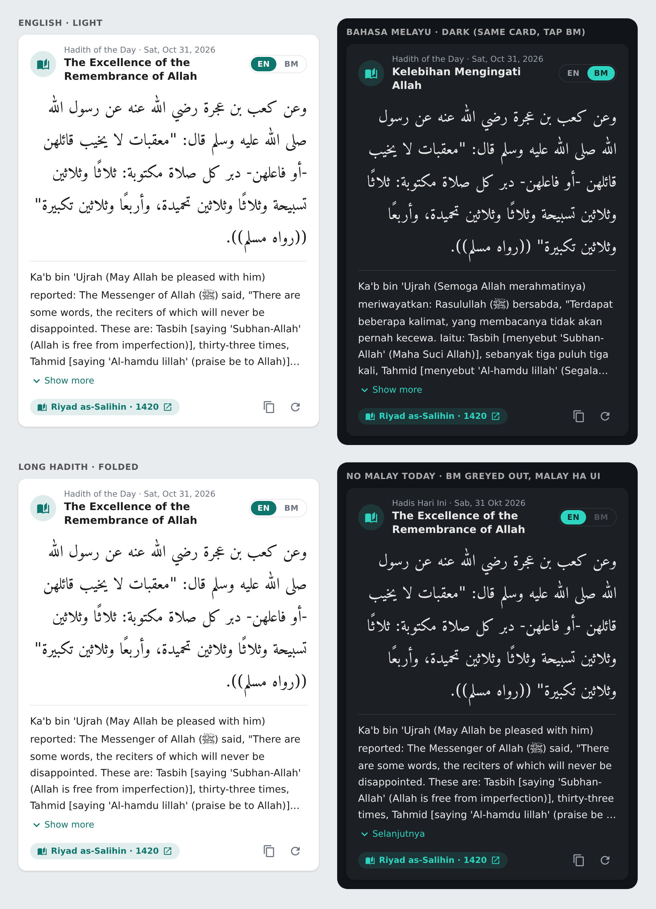

[](https://github.com/hacs/default)
[](https://github.com/hacs/integration)

[](https://sunnah.com/donate)
[](https://github.com/zubir2k/homeassistant-dailyhadith/releases/)

Assalamu'alaikum

This is a custom integration on Daily Hadith from Sunnah.com for your Home Assistant 🏠 \
_May this benefit you, inshaAllah._

## 🛠️ What's New in 1.3.0

- **Translate into your own language** with your own AI: Home Assistant **AI Task / Assist** (ChatGPT, Claude, Google Gemini, Ollama…) or any **OpenAI-compatible API** (OpenAI, Ollama, OpenRouter, Groq, LM Studio, Cloudflare Workers AI…). See [Translation](#-translation).
- Bahasa Melayu stays free and needs no setup when you use the shared feed (no API key).
- The card's switch now shows your language (EN / BM / ID / TR…), and the heading, chapter title and date follow the language you pick.
- New attributes: `translation`, `title_translation`, `translation_language`, `translation_source`.
- New diagnostic sensor `sensor.daily_hadith_translation`: translation status (not needed, translating, translated, failed, needs a translator), with the last error, duration and next retry in its attributes.
- API-key users: Malay now comes from your own translator (eliminating any external Cloudflare Worker reliance). If none is set, Home Assistant shows a repair notice and the card stays in English.

## 🛠️ What's New in 1.2.0

- Bundled **Daily Hadith card** with an EN / BM switch (see below).
- Malay translation (`malay`, `title_ms`) for API-key users too.

## 🛠️ What's New in 1.1.0 (ready for Home Assistant 2026.11)

- Fixed loading on current Home Assistant: the `async_timeout` package is no longer shipped with HA.
- The hadith now changes at midnight in **your Home Assistant time zone**, and catches up after a restart if HA was off at midnight.
- If the Sunnah.com API is down, the integration falls back to the shared hadith of the day instead of going unavailable.
- Add, change or remove your API key any time: **Settings → Devices & services → Daily Hadith → ⋮ → Reconfigure**.
- New attributes: `url` (link to the hadith on Sunnah.com) and `source`.
- Daily Hadith now shows as a service device, with English and Malay translations for the setup, sensor and action.
- New `malay` and `title_ms` attributes (Bahasa Melayu), translated cleanly via your configured AI translator.
- Long `text`, `arabic` and `malay` attributes are no longer stored in the recorder database.
- Your existing `sensor.daily_hadith` entity and automations keep working. Minimum Home Assistant version is now 2024.11.

## 🚩 Features
- Daily random hadith which refreshes at midnight (your Home Assistant time zone).
- Works without an API key using the shared hadith of the day.
- `daily_hadith.reload` action to fetch a new hadith on demand.
- Information includes hadith in `arabic`, `english` and `malay`
- Full references from chapters, collection names, etc.


## 🎯 Use Cases
- Display daily hadith on your Home Assistant dashboard
- Automate daily hadith via notifications, or instant messaging (e.g. Family Group)


## 🕹️ Installation
#### With HACS
[](https://my.home-assistant.io/redirect/hacs_repository/?owner=zubir2k&repository=homeassistant-dailyhadith&category=integration)

> [!Tip]
> If you are unable to use the button above, manually search for Daily Hadith in HACS.

#### Manual
1. Copy the `daily_hadith` directory from `custom_components` in this repository and place inside your Home Assistant's `custom_components` directory.
2. Restart Home Assistant
3. Follow the instructions in the `Setup` section

> [!WARNING]
> If installing manually, in order to be alerted about new releases, you will need to subscribe to releases from this repository.

## 📦 Setup
[](https://my.home-assistant.io/redirect/config_flow_start/?domain=daily_hadith)

> [!Tip]
> If you are unable to use the button above, follow the steps below:
> 1. Navigate to the Home Assistant Integrations page (Settings --> Devices & Services)
> 2. Click the `+ ADD INTEGRATION` button in the lower right-hand corner
> 3. Search for `Daily Hadith`
> 4. Enter your API key from Sunnah.com. Leave empty if you have no API key and press Submit.
> 
> Create an `Issue` at Sunnah.com Github Repository to request for the API key [here](https://github.com/sunnah-com/api/issues/new?template=request-for-api-access.md&title=Request+for+API+access%3A+%5BYour+Name%5D)

## 🌐 Translation

Arabic and English are always included. For a third language, open **Settings → Devices & services → Daily Hadith → Configure** and pick:

1. **Language**: the language shown on the card's second button. Bahasa Melayu is the default. Not in the list? Type its code (for example `pt-BR`).
2. **Translator**:
   - **None**: English only, or Malay from the shared feed (when using without a Sunnah.com API key).
   - **Home Assistant AI Task / Assist**: uses an AI integration you already have (OpenAI, Anthropic, Google Gemini, Ollama and others). Leave the entity empty to use your default AI Task or Assist agent.
   - **OpenAI-compatible API**: a base URL, an optional API key and a model.

| Service | Base URL | Model example |
|---|---|---|
| OpenAI | `https://api.openai.com/v1` | `gpt-4o-mini` |
| Ollama (local) | `http://<host>:11434/v1` | `llama3.1` |
| OpenRouter | `https://openrouter.ai/api/v1` | `openai/gpt-4o-mini` |
| Cloudflare Workers AI | `https://api.cloudflare.com/client/v4/accounts/<account_id>/ai/v1` | `@cf/google/gemma-4-26b-a4b-it` |

A short test translation runs when you save. Each hadith is translated once (body and chapter title) and kept with the day's hadith, so a reload or restart doesn't call your AI again. The hadith shows in English straight away and the translation follows when your AI answers; if it fails, it tries again 15 minutes later.

> [!NOTE]
> Translations are made by AI and are not reviewed. Smaller local models can struggle with less common languages. Check the original on Sunnah.com before relying on a translation.

## 🃏 Daily Hadith Card

The integration ships its own dashboard card. No extra download and no resource to add: it is registered automatically (for YAML-managed dashboards the script is injected instead).



- Arabic text in the bundled Amiri font, right to left
- **Language switch** on the card: EN and your translation language (BM, ID, TR…). Your choice is remembered per browser. The heading, chapter title and date follow the language shown. The button is greyed out until the translation is ready
- Small "AI translation" note under translated text
- Long hadith fold behind **Show more**
- Reference chip that opens the hadith on Sunnah.com
- Copy button and a refresh button (calls `daily_hadith.reload`)
- Follows your Home Assistant theme, light and dark
- Visual editor: find **Daily Hadith** in the card picker

```yaml
type: custom:daily-hadith-card
entity: sensor.daily_hadith   # optional
language: auto                # auto | en | translation (starting language)
show_arabic: true
show_translation: true
show_toggle: true
show_header: true
show_reference: true
show_refresh: true
show_copy: true
show_ai_note: true
collapse: true
```

## 🗑️ Removal

1. Remove any Daily Hadith cards from your dashboards.
2. Go to **Settings → Devices & services → Daily Hadith → ⋮ → Delete**. This also deletes the cached hadith and the card's dashboard resource.
3. Uninstall it from HACS / the Marketplace (or delete `custom_components/daily_hadith`) and restart Home Assistant.

## 🎖️ Credits
Data provided by Sunnah.com. Learn [more](https://sunnah.com/about) about Sunnah.com

## 📢 Join the Community
[Home Assistant Official Community](https://community.home-assistant.io/t/custom-integrations-daily-hadith/) \
[Home Assistant Malaysia](https://www.facebook.com/groups/homeassistantmalaysia)
