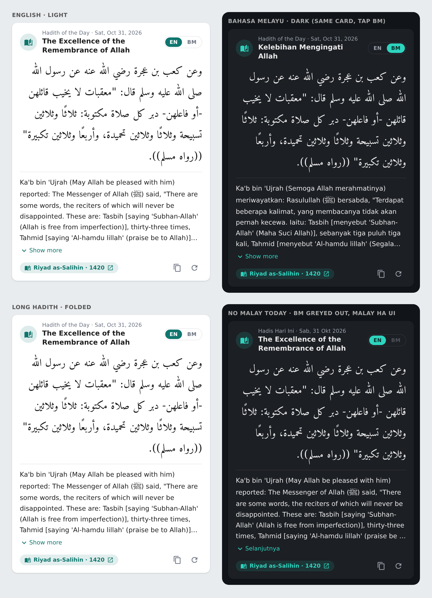

[](https://github.com/hacs/default)
[](https://github.com/hacs/integration)

[](https://sunnah.com/donate)
[](https://github.com/zubir2k/homeassistant-dailyhadith/releases/)

Assalamu'alaikum

This is a custom integration on Daily Hadith from Sunnah.com for your Home Assistant 🏠 \
_May this benefit you, inshaAllah._

## 🛠️ What's New in 1.2.0

- Bundled **Daily Hadith card** with an EN / BM switch (see below).
- Malay translation (`malay`, `title_ms`) for API-key users too.

## 🛠️ What's New in 1.1.0 (ready for Home Assistant 2026.11)

- Fixed loading on current Home Assistant: the `async_timeout` package is no longer shipped with HA.
- The hadith now changes at midnight in **your Home Assistant time zone**, and catches up after a restart if HA was off at midnight.
- If the Sunnah.com API is down, the integration falls back to the shared hadith of the day instead of going unavailable.
- Add, change or remove your API key any time: **Settings → Devices & services → Daily Hadith → ⋮ → Reconfigure**.
- New attributes: `url` (link to the hadith on Sunnah.com) and `source`.
- Daily Hadith now shows as a service device, with English and Malay translations for the setup, sensor and action.
- New `malay` and `title_ms` attributes (Bahasa Melayu). The fallback feed already includes them; with an API key the integration translates through the hadith translator worker.
- Long `text`, `arabic` and `malay` attributes are no longer stored in the recorder database.
- Your existing `sensor.daily_hadith` entity and automations keep working. Minimum Home Assistant version is now 2024.11.

## 🚩 Features
- Daily random hadith which refreshes at midnight (your Home Assistant time zone).
- Works without an API key using the shared hadith of the day.
- `daily_hadith.reload` action to fetch a new hadith on demand.
- Information includes hadith in `arabic`, `english` and `malay`
- Full references from chapters, collection names, etc.


## 🎯 Use Cases
- Display daily hadith on your Home Assistant dashboard
- Automate daily hadith via notifications, or instant messaging (e.g. Family Group)


## 🕹️ Installation
#### With HACS
[](https://my.home-assistant.io/redirect/hacs_repository/?owner=zubir2k&repository=homeassistant-dailyhadith&category=integration)

> [!Tip]
> If you are unable to use the button above, manually search for Daily Hadith in HACS.

#### Manual
1. Copy the `daily_hadith` directory from `custom_components` in this repository and place inside your Home Assistant's `custom_components` directory.
2. Restart Home Assistant
3. Follow the instructions in the `Setup` section

> [!WARNING]
> If installing manually, in order to be alerted about new releases, you will need to subscribe to releases from this repository.

## 📦 Setup
[](https://my.home-assistant.io/redirect/config_flow_start/?domain=daily_hadith)

> [!Tip]
> If you are unable to use the button above, follow the steps below:
> 1. Navigate to the Home Assistant Integrations page (Settings --> Devices & Services)
> 2. Click the `+ ADD INTEGRATION` button in the lower right-hand corner
> 3. Search for `Daily Hadith`
> 4. Enter your API key from Sunnah.com. Leave empty if you have no API key and press Submit.
> 
> Create an `Issue` at Sunnah.com Github Repository to request for the API key [here](https://github.com/sunnah-com/api/issues/new?template=request-for-api-access.md&title=Request+for+API+access%3A+%5BYour+Name%5D)

## 🃏 Daily Hadith Card (new in 1.2.0)

The integration ships its own dashboard card. No extra download and no resource to add: it is registered automatically (for YAML-managed dashboards the script is injected instead).



- Arabic text in the bundled Amiri font, right to left
- **EN / BM switch** on the card. Your choice is remembered per browser. BM is greyed out on days the Malay translation is missing
- Long hadith fold behind **Show more**
- Reference chip that opens the hadith on Sunnah.com
- Copy button and a refresh button (calls `daily_hadith.reload`)
- Follows your Home Assistant theme, light and dark
- Visual editor: find **Daily Hadith** in the card picker

```yaml
type: custom:daily-hadith-card
entity: sensor.daily_hadith   # optional
language: auto                # auto | en | ms (starting translation)
show_arabic: true
show_translation: true
show_toggle: true
show_header: true
show_reference: true
show_refresh: true
show_copy: true
collapse: true
```

## 🗑️ Removal

1. Remove any Daily Hadith cards from your dashboards.
2. Go to **Settings → Devices & services → Daily Hadith → ⋮ → Delete**. This also deletes the cached hadith and the card's dashboard resource.
3. Uninstall it from HACS / the Marketplace (or delete `custom_components/daily_hadith`) and restart Home Assistant.

## 🎖️ Credits
Data provided by Sunnah.com. Learn [more](https://sunnah.com/about) about Sunnah.com

## 📢 Join the Community
[Home Assistant Official Community](https://community.home-assistant.io/t/custom-integrations-daily-hadith/) \
[Home Assistant Malaysia](https://www.facebook.com/groups/homeassistantmalaysia)
